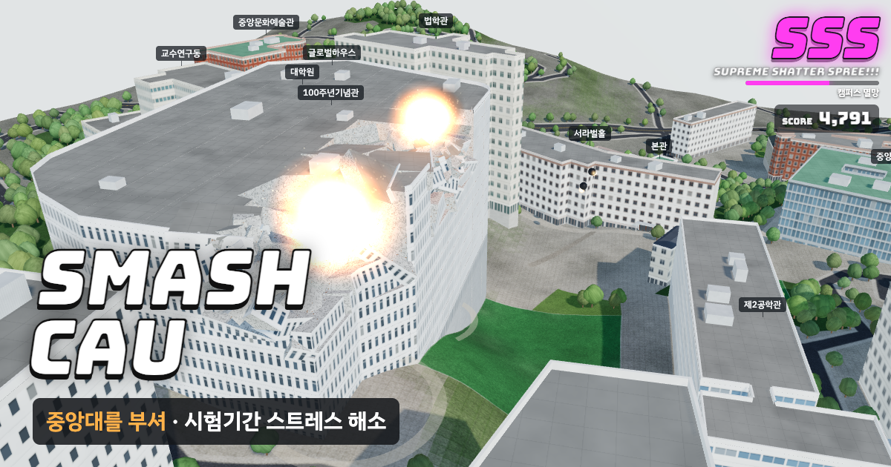

# SMASH CAU

중앙대학교 서울캠퍼스를 3D로 부수는 브라우저 게임입니다. 시험 기간 스트레스 해소용입니다.

학교와 관계없는 비공식 팬 게임입니다.

**바로 하기:** https://hong-iron.github.io/SMASH-CAU/

## 하는 법

- 건물을 누르면 고른 도구로 부숩니다. 떨어진 조각을 또 누르면 더 잘게 부서집니다.
- 도구는 여섯 가지입니다. 숫자 키 1~6으로도 바꿀 수 있습니다.
  - 폭탄: 넓게 날려 버리고, 땅에 떨어지면 구덩이를 팝니다.
  - 야구 배트: 거대한 배트로 쳐서 덩어리를 멀리 날립니다. 70 m 넘게 날아가면 홈런 보너스를 받습니다.
  - 레이저: 화면을 끌어 선을 그으면 하늘이 어두워지며 충전한 뒤, 세 겹의 굵은 빔이 그 선을 훑습니다. 지나가는 곳마다 연쇄 폭발이 일어나고 양옆 건물이 튕겨 날아가며, 땅에는 녹아 빛나는 홈이 남습니다. 톡 누르면 한 점만 태웁니다.
  - 운석: 카메라가 떨어지는 운석을 따라가고, 부딪힌 곳에 큰 구덩이가 생깁니다.
  - 지진: 규모 8.4~9.6의 대지진이 3초 동안 캠퍼스 전체를 흔듭니다. 땅이 파도처럼 출렁이고 높은 건물일수록 크게 휘청이며, 1층이 꺼지면서 건물이 통째로 주저앉고 땅이 여러 번 갈라집니다.
  - 핵폭탄: 카메라가 떨어지는 핵폭탄을 따라가다가, 터지는 순간 느린 화면과 섬광, 거대한 버섯구름이 나옵니다. 반경 380 m 안이 통째로 날아가고 깊은 구덩이가 생깁니다.
  - 운석과 핵폭탄 연출 중에 화면을 누르거나 Esc를 누르면 건너뜁니다.
- 부술 때마다 스타일 랭크가 D → C → B → A → S → SS → SSS로 오르고 점수가 쌓입니다.
  - 도구를 바꿔 가며 빠르게 부수면 배율이 붙습니다. 같은 도구만 계속 쓰면 깎입니다.
  - 공중에 뜬 조각을 치면 공중 콤보, 건물 하나를 다 무너뜨리면 붕괴 보너스를 받습니다.
  - 휴대폰에서는 한 손가락으로 끌어 화면을 옮기고, 두 손가락으로 돌리거나 확대합니다. 레이저를 고르면 한 손가락 끌기가 레이저 선 긋기로 바뀝니다.
  - 잠시 손을 놓으면 랭크가 서서히 내려갑니다.
- 땅을 계속 파면 흙 → 지각 → 맨틀 → 외핵 → 내핵을 지나 지구 중심까지 내려갑니다. 화면 아래 깊이 표시는 실제 깊이(km)로 바꿔 보여 줍니다.
- 되돌리기(Ctrl+Z, Mac은 ⌘Z)는 한 단계씩, 전부 복구는 처음 상태로 돌아갑니다.
- 화면 조작: 끌기는 돌리기, 오른쪽 끌기는 옮기기, 휠은 확대입니다.

## 개발자 응원하기

재미있게 하셨다면 커피 한 잔으로 응원해 주세요: https://buymeacoffee.com/hongiron

## 데이터와 출처

- 건물 모양과 층수, 도로, 녹지: © OpenStreetMap 기여자 (ODbL). `data/campus.json`도 ODbL을 따릅니다.
- 땅 높이: AWS Terrain Tiles (Mapzen terrarium 형식, SRTM 30 m 기반).
- 100주년기념관 층수(지상 12층, 지하 6층): 대학저널 2016년 준공 보도.
- OpenStreetMap에 층수가 없는 건물 6동은 4층으로 어림했습니다.
- 건물 겉모습(창문, 벽돌, 유리)은 실제 사진이 아니라 코드로 그린 일반 재질입니다.

## 만든 방법

- 같은 방식으로 만든 다른 학교: [SMASH SSU](https://github.com/Hong-Iron/SMASH-SSU), [SMASH SNU](https://github.com/Hong-Iron/SMASH-SNU)
- 3D는 three.js r160(CDN), 소리는 Web Audio로 합성합니다. 소리 파일은 없습니다.
- 학교 이름, 주소, 미리보기 문구, 건물별 재질 지정은 `config.json`에 있습니다.
- 페이지 만들기: `src/app.html` + `data/campus.json` + `config.json` → `python3 tools/assemble.py` → `site/index.html`
- 데이터 다시 만들기 (numpy, matplotlib 필요):
  1. `python3 tools/fetch.py way 284355223 raw`
  2. `python3 tools/build_campus.py raw raw/campus_raw.json`
  3. `python3 tools/add_trees.py raw/campus_raw.json data/campus.json`
  - 100주년기념관 층수(지상 12층)는 OpenStreetMap에 없어서 지금 `data/campus.json`에만 들어 있습니다. 데이터를 다시 만들면 직접 넣어야 합니다.
- `main`에 push하면 GitHub Actions가 `site/` 폴더를 GitHub Pages에 올립니다.
